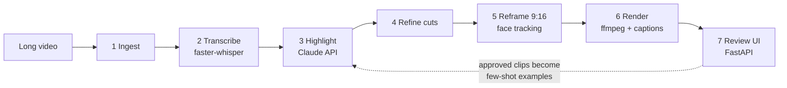

# ClipForge

[](https://github.com/Juandr0322/clipforge/actions/workflows/tests.yml)


AI agent that turns long-form video into short-form vertical clips —
transcription, LLM highlight detection, clean cut refinement, auto-reframe
to 9:16, word-synced captions, and a review UI with a feedback loop.

Built by **Juan Diego Ramirez** (Computer Engineering, Boston University).



**Tech stack:** Python · faster-whisper · Anthropic Claude API · MediaPipe / OpenCV ·
ffmpeg + libass · FastAPI · Pydantic · pytest · GitHub Actions

## Status: all 7 modules complete — 229 tests passing (incl. browser tests)

| Module | What it does |
|---|---|
| 1. Ingestion | probe/validate/normalize, extract audio, 480p proxy |
| 2. Transcription | faster-whisper, word-level timestamps |
| 3. Highlight detection | Claude ranks clip candidates; few-shot library |
| 4. Boundary refinement | sentence snap + silence-aware cuts |
| 5. Visual reframing | face tracking -> smoothed 9:16 camera path |
| 6. Render | dynamic crop, burned ASS captions, -14 LUFS, 1080x1920 |
| 7. Review UI | web app: approve/reject/trim, metrics, feedback export |

## Setup

Python 3.11+ and ffmpeg on PATH.

```bash
pip install -r requirements.txt
pip install mediapipe          # optional, better face tracking than haar
export ANTHROPIC_API_KEY=...   # for real highlight detection
```

Or copy `.env.example` to `.env` and put the key there: the CLI loads it
automatically (real environment variables win). `.env` is git-ignored.

## Run the web app (recommended)

```bash
python -m clipforge.cli serve
# open http://localhost:8000 — upload a video, wait, review clips
```

The review site is built for getting through a batch fast:

- **Keyboard review:** `J`/`K` next/previous clip, `A` approve, `R` reject,
  `Space` play, `[` / `]` set trim start/end from the playhead, `?` help
- **Filter and sort:** unreviewed / approved / rejected with counts; sort by score or time
- **Upload:** drag and drop (several files queue up), live progress, clear errors
- **Live updates without interruptions:** videos keep playing and half-typed
  notes survive background refreshes; the page stops polling when nothing runs
- **Works on a phone** (390px layout)
- **Hardened:** all text escaped, job/clip ids validated against path traversal,
  concurrency-safe review saves (Windows-safe file replace), no internal paths in errors

Engine overrides via env: `CLIPFORGE_ASR` (whisper:small|whisper:medium|mock),
`CLIPFORGE_HL` (anthropic|mock), `CLIPFORGE_DETECTOR` (mediapipe|haar),
`CLIPFORGE_EXAMPLES` (few-shot dir; defaults to ./examples via export).

## Or run stage by stage (CLI)

```bash
python -m clipforge.cli ingest video.mp4
python -m clipforge.cli transcribe <job> --engine whisper:small
python -m clipforge.cli highlight  <job> --engine anthropic --examples-dir examples
python -m clipforge.cli refine     <job>
python -m clipforge.cli reframe    <job>            # mediapipe or haar
python -m clipforge.cli render     <job>
python -m clipforge.cli pipeline   <job>            # or: all remaining stages
python -m clipforge.cli status     <job>
```

Outputs land in `workspace/<job>/renders/` (clips + QA contact sheets).

## The feedback loop

Review clips in the UI (approve / reject / trim / note). Then click
"export approved -> few-shot examples". Approved clips become example files
that calibrate Module 3's prompt on the next run — the system learns your
taste from your own decisions. Metrics to watch over time (shown in the
header): **approval rate** should rise, **avg trim adjustment** should fall.

## Architecture

- Modules communicate ONLY through JSON files in the job dir
  (`manifest.json` is the state machine + audit trail).
- Every stage is idempotent and resumable; failures record the error and
  preserve progress.
- Every stage verifies its own outputs before marking itself done.
- Engines (ASR / LLM / face detector) are swappable interfaces with mock
  implementations, so the entire pipeline is testable offline.

Full stage-by-stage map: [`docs/ARCHITECTURE.md`](docs/ARCHITECTURE.md).

## Built with an AI agent team

Development runs through a small team of Claude Code agents defined in
[`.claude/`](.claude/) (details in [`docs/AGENT_TEAM.md`](docs/AGENT_TEAM.md)):

| Agent | Job |
|---|---|
| planner | turns goals into [`docs/SPEC.md`](docs/SPEC.md) + [`docs/features.json`](docs/features.json) with testable acceptance criteria |
| builder | implements one feature per branch, with tests |
| reviewer | fresh-context code review of the diff; can fail a feature |
| tester | runs the suite and drives the real site in a browser (Playwright) |
| explore | cheap read-only lookups |

Every feature goes builder → reviewer → merge → tester, capped at two fix
rounds. Findings are logged in [`docs/findings.log`](docs/findings.log), and
`/retro` turns repeated mistakes into rules in `docs/LESSONS.md` (human-approved).
Real catches so far: a path-traversal read outside the workspace, reviews landing
on the wrong job after switching jobs, lost reviews under concurrent saves, a
Windows-only file-replace race, and a flaky test traced to an out-of-range ffmpeg argument.

## Testing

```bash
python -m pytest tests/ -q     # fully offline (mock engines); lint: python -m pyflakes clipforge tests
```

Browser tests (Playwright, ~15 min) are opt-in:

```bash
pip install -r requirements-dev.txt && python -m playwright install chromium
CLIPFORGE_BROWSER_TESTS=1 python -m pytest tests/test_ui_browser.py -q
```

## Roadmap

Next upgrades, informed by 2026 short-form platform research:

- [ ] Platform profiles (length limits, caption safe zones per app)
- [ ] Smarter highlight picking: moments that make sense to a stranger
- [ ] Hook-first trimming and a first-3-seconds hook score
- [ ] Originality layer: context overlay, punch-in zooms, end cards
- [ ] Word-chunked captions and a pacing check
- [ ] Hook variants and loop-point detection
- [ ] Per-platform exports
- [x] Review website: fast keyboard review, drag-and-drop upload, phone layout, security hardening
- [ ] Review UI as a control panel (hook scores, variants, per-platform approval)
- [ ] Learning loop: clip database + real performance data fed back into highlight selection

## Scaling later (deliberately not built yet)

Single-user prototype by design. To commercialize: real job queue
(Celery/Redis) instead of threads, auth, object storage for videos,
GPU workers for Whisper/rendering, and per-user workspaces. The
file-contract architecture means none of that touches module internals.
